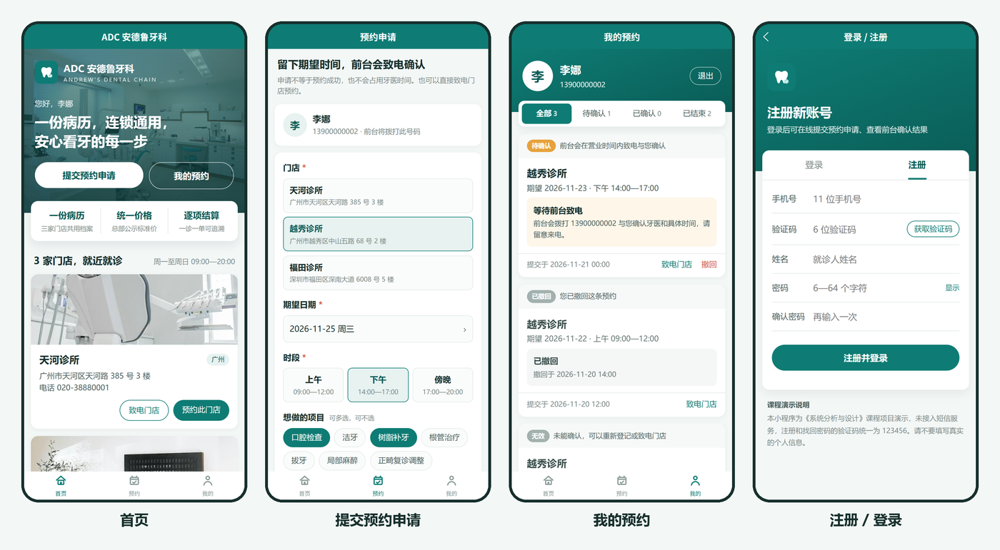

# ADC 牙科连锁诊所运营管理系统

《系统分析与设计》课程项目 · 信管2401 曾梓钰 1602240103

系统面向一家在广州、深圳有三家门店的牙科连锁诊所，包含**员工后台**（前台、牙医、总部三个岗位）、**患者官网**和**微信小程序“ADC预约助手”**，三端共用同一个后端和数据库。需求分析与设计见课程报告 [1602240103曾梓钰.pdf](1602240103曾梓钰.pdf)（[Word 版](1602240103曾梓钰.docx)），使用方法见 [ADC系统访问说明.docx](ADC系统访问说明.docx)。

## 在线体验

| 入口 | 地址 | 说明 |
|---|---|---|
| 患者官网 | https://zengziyu.cn | 门店、医生、价格公示、费用估算；注册登录后提交预约申请 |
| 员工后台 | https://zengziyu.cn/login | 前台、牙医、总部三个岗位登录后使用 |
| 小程序网页体验版 | https://zengziyu.cn/mp/ | 微信小程序的网页版，电脑在手机模型中操作，手机打开即全屏 |

演示账号的密码均为 `123456`（仅用于课程演示）：

| 使用者 | 登录名 | 姓名 |
|---|---|---|
| 前台 | `front1` | 王丽 |
| 牙医 | `dentist1` / `dentist2` / `dentist3` / `dentist4` | 林嘉文 / 周明远 / 黄晓雯 / 吴志强 |
| 总部 | `hq1` | 陈总部 |
| 患者（官网、小程序） | `13900000001` / `13900000002` | 张伟 / 李娜 |

演示数据每天自动滚动补充，任何日期打开都有当天的预约和近期的业务记录。也可以在官网或小程序里自行注册患者账号，注册验证码统一为 `123456`（未接入短信服务），请不要填写真实的个人信息。线上数据由所有访问者共用。

## 微信小程序“ADC预约助手”



功能：首页（门店、医生、价格）、提交预约申请、我的预约（查看处理结果、撤回）、注册登录。与官网使用同一组患者接口，小程序提交的申请会出现在员工后台前台的“预约申请”页。

<!--
  小程序上线后：把下面“当前状态”改为“已上线”，删掉“暂未上线时”一节，
  并把小程序码图片放到 docs/images/miniprogram-code.png（小程序后台“设置 → 基本设置”可下载）。
-->

**当前状态：备案与审核进行中，暂未正式上线。**

暂未上线时，可以用下面两种方式查看：

1. **网页体验版（推荐，无需微信）**：打开 https://zengziyu.cn/mp/ ，或用手机扫描下方二维码。它由同一套代码编译而成，页面和功能与微信中一致，账号和数据互通。

   

2. **在微信中打开体验版**：把您的微信号告诉作者，作者在小程序后台“成员管理”中将您添加为**体验成员**，之后扫描作者提供的体验版二维码即可在微信里打开。

上线后：微信搜索“ADC预约助手”，或扫描小程序码打开。

## 目录

| 目录 | 内容 |
|---|---|
| `frontend` | 网页前端：员工后台与患者官网（Vue 3 + Vite + Element Plus） |
| `miniprogram` | 微信小程序（uni-app + Vue 3），同一套代码也编译为网页体验版；`web/` 为体验版的展示页 |
| `shared` | 网页和小程序共用的代码：状态文字、显示格式、请求标识 |
| `backend` | 后端（Spring Boot 4 + MySQL 8 + Flyway） |
| `docs` | 前后端协作约定（接口、状态、错误格式、示例数据） |

## 部署

阿里云 ECS（Windows Server 2022）上运行 Nginx、后端 jar 和 MySQL 8：Nginx 在 80/443 端口提供网页并把 `/api` 转发到只监听本机的后端，`/mp/` 为小程序网页体验版；数据库只监听本机。域名 zengziyu.cn 已备案并配置 HTTPS。详见课程报告第十三部分。

## 本地运行

**后端**（需要 JDK 17 和 MySQL 8）：在 `backend` 目录新建 `application-local.properties` 写入数据库连接（该文件不上传），然后

```
cd backend
.\mvnw.cmd spring-boot:run
```

使用 `demo` 配置（环境变量 `SPRING_PROFILES_ACTIVE=demo`）时，Flyway 会自动建表并写入演示数据。

**网页前端**（需要 Node.js）：

```
cd frontend
npm install
npm run dev        # http://localhost:5173 ，连接本机 8080 的后端
npm run dev:mock   # http://localhost:5174 ，使用浏览器内的模拟数据，不需要后端
npm run build      # 正式打包，只连接真实后端
```

**小程序**：

```
cd miniprogram
npm install
npx uni build -p mp-weixin   # 输出到 dist/build/mp-weixin，用微信开发者工具导入
npx uni build                # 网页体验版，输出到 dist/build/h5
```

## 作者

曾梓钰（信管2401，1602240103）独立完成需求分析、系统设计、开发与部署。代码编写过程中使用了 Claude 和 ChatGPT。
